# DEPENDENCIES — do thi phu thuoc cua doi nami-agent-teams

> File sinh tu dong boi `node tools/dependency-report.mjs`. KHONG sua tay: sua du lieu goc roi chay lai.
> Nguon: `.agent-teams/nami-agent-teams/team.json` (canh that) + `docs/provenance-tasks.json` (canh provenance).
> Sinh luc: 2026-11-01T03:07:53.742Z · pha doi: **running** · 127 task / 15 member.

## 1. Cach doc

| Ky hieu | Nghia |
| --- | --- |
| `-->` | Phu thuoc THAT trong DAG cua doi (tool va scheduler cung thay) |
| `-.->` + nhan | Quan he provenance: task nay sinh ra tu task kia. DAG khong giu duoc vi `agent_teams_edit_plan` tu choi task da start |
| ✅ / 🔄 / ⬜ / ❌ | completed / in_progress / pending / failed |
| Song N | Muc toi thieu cua do thi: moi task chi phu thuoc task o song nho hon |

```mermaid
flowchart LR
  subgraph W0["Song 0"]
    direction TB
    t1["t1<br/>✅ completed<br/>nghien-cuu"]
    t9["t9<br/>✅ completed<br/>dev-tools-flash"]
    t57["t57<br/>✅ completed<br/>dev-ui-goat"]
  end
  subgraph W1["Song 1"]
    direction TB
    t2["t2<br/>✅ completed<br/>nghien-cuu"]
    t5["t5<br/>✅ completed<br/>kiem-thu"]
    t22["t22<br/>✅ completed<br/>dev-tools-flash"]
    t60["t60<br/>✅ completed<br/>dev-ui-goat"]
  end
  subgraph W2["Song 2"]
    direction TB
    t3["t3<br/>✅ completed<br/>dev-runtime-flash"]
    t4["t4<br/>✅ completed<br/>dev-tools-flash"]
  end
  subgraph W3["Song 3"]
    direction TB
    t6["t6<br/>✅ completed<br/>audit-kimi"]
    t10["t10<br/>✅ completed<br/>dev-ui-goat"]
    t14["t14<br/>✅ completed<br/>dev-runtime-flash"]
    t15["t15<br/>✅ completed<br/>dev-runtime-flash"]
    t16["t16<br/>✅ completed<br/>dev-tools-flash"]
    t20["t20<br/>✅ completed<br/>nghien-cuu"]
  end
  subgraph W4["Song 4"]
    direction TB
    t7["t7<br/>✅ completed<br/>nghien-cuu"]
    t8["t8<br/>✅ completed<br/>dev-tools-flash"]
    t17["t17<br/>✅ completed<br/>dev-runtime-flash"]
    t18["t18<br/>✅ completed<br/>kiem-thu"]
    t21["t21<br/>✅ completed<br/>kiem-thu"]
  end
  subgraph W5["Song 5"]
    direction TB
    t19["t19<br/>✅ completed<br/>audit-kimi"]
  end
  subgraph W6["Song 6"]
    direction TB
    t11["t11<br/>✅ completed<br/>kiem-thu-goat"]
  end
  subgraph W7["Song 7"]
    direction TB
    t12["t12<br/>✅ completed<br/>audit-goat"]
  end
  subgraph W8["Song 8"]
    direction TB
    t13["t13<br/>✅ completed<br/>dev-ui-goat"]
    t23["t23<br/>✅ completed<br/>dev-build-flash"]
    t24["t24<br/>✅ completed<br/>kiem-thu-goat"]
  end
  subgraph W9["Song 9"]
    direction TB
    t25["t25<br/>✅ completed<br/>dev-ui-goat"]
  end
  subgraph W10["Song 10"]
    direction TB
    t26["t26<br/>✅ completed<br/>audit-goat"]
  end
  subgraph W11["Song 11"]
    direction TB
    t27["t27<br/>✅ completed<br/>kiem-thu-goat"]
    t28["t28<br/>✅ completed<br/>dev-runtime-goat"]
    t29["t29<br/>✅ completed<br/>dev-build-flash"]
  end
  subgraph W12["Song 12"]
    direction TB
    t30["t30<br/>✅ completed<br/>dev-build-flash"]
    t32["t32<br/>✅ completed<br/>dev-ui-goat"]
  end
  subgraph W13["Song 13"]
    direction TB
    t31["t31<br/>✅ completed<br/>audit-goat"]
  end
  subgraph W14["Song 14"]
    direction TB
    t33["t33<br/>✅ completed<br/>dev-ui-goat"]
    t34["t34<br/>✅ completed<br/>dev-ui-goat"]
  end
  subgraph W15["Song 15"]
    direction TB
    t35["t35<br/>✅ completed<br/>dev-build-flash"]
  end
  subgraph W16["Song 16"]
    direction TB
    t36["t36<br/>✅ completed<br/>audit-goat"]
  end
  subgraph W17["Song 17"]
    direction TB
    t37["t37<br/>✅ completed<br/>dev-runtime-goat"]
    t40["t40<br/>✅ completed<br/>kiem-thu-goat"]
  end
  subgraph W18["Song 18"]
    direction TB
    t38["t38<br/>✅ completed<br/>dev-runtime-goat"]
    t39["t39<br/>✅ completed<br/>dev-ui-goat"]
    t44["t44<br/>✅ completed<br/>dev-build-flash"]
    t45["t45<br/>✅ completed<br/>kiem-thu-goat"]
    t58["t58<br/>✅ completed<br/>dev-runtime-goat"]
  end
  subgraph W19["Song 19"]
    direction TB
    t41["t41<br/>✅ completed<br/>dev-build-flash"]
    t43["t43<br/>✅ completed<br/>dev-runtime-goat"]
  end
  subgraph W20["Song 20"]
    direction TB
    t47["t47<br/>✅ completed<br/>dev-runtime-goat"]
    t48["t48<br/>✅ completed<br/>dev-runtime-goat"]
  end
  subgraph W21["Song 21"]
    direction TB
    t46["t46<br/>✅ completed<br/>dev-ui-goat"]
    t51["t51<br/>❌ failed<br/>kiem-thu-goat"]
    t54["t54<br/>✅ completed<br/>dev-runtime-goat"]
  end
  subgraph W22["Song 22"]
    direction TB
    t42["t42<br/>✅ completed<br/>audit-goat"]
    t49["t49<br/>✅ completed<br/>dev-ui-goat"]
    t55["t55<br/>✅ completed<br/>kiem-thu-goat"]
    t56["t56<br/>✅ completed<br/>dev-runtime-goat"]
  end
  subgraph W23["Song 23"]
    direction TB
    t50["t50<br/>✅ completed<br/>dev-runtime-goat"]
  end
  subgraph W24["Song 24"]
    direction TB
    t52["t52<br/>✅ completed<br/>dev-build-flash"]
  end
  subgraph W25["Song 25"]
    direction TB
    t53["t53<br/>✅ completed<br/>audit-goat"]
    t59["t59<br/>✅ completed<br/>kiem-thu-goat"]
  end
  subgraph W26["Song 26"]
    direction TB
    t61["t61<br/>✅ completed<br/>audit-goat"]
    t82["t82<br/>✅ completed<br/>kiem-thu-goat"]
  end
  subgraph W27["Song 27"]
    direction TB
    t62["t62<br/>✅ completed<br/>dev-ui-goat"]
    t65["t65<br/>✅ completed<br/>dev-runtime-goat"]
    t86["t86<br/>✅ completed<br/>dev-runtime-goat"]
  end
  subgraph W28["Song 28"]
    direction TB
    t63["t63<br/>⛔ cancelled<br/>captain"]
    t67["t67<br/>✅ completed<br/>dev-ui-goat"]
    t87["t87<br/>✅ completed<br/>dev-runtime-goat"]
  end
  subgraph W29["Song 29"]
    direction TB
    t64["t64<br/>⛔ cancelled<br/>audit-goat"]
    t66["t66<br/>⬜ pending<br/>audit-goat"]
    t68["t68<br/>✅ completed<br/>dev-build-flash"]
    t88["t88<br/>✅ completed<br/>dev-build-flash"]
    t90["t90<br/>✅ completed<br/>dev-runtime-goat"]
  end
  subgraph W30["Song 30"]
    direction TB
    t69["t69<br/>✅ completed<br/>audit-goat"]
    t89["t89<br/>✅ completed<br/>audit-goat"]
    t92["t92<br/>⛔ cancelled<br/>captain"]
    t94["t94<br/>✅ completed<br/>dev-runtime-goat"]
  end
  subgraph W31["Song 31"]
    direction TB
    t70["t70<br/>✅ completed<br/>dev-ui-goat"]
    t91["t91<br/>✅ completed<br/>kiem-thu-goat"]
    t93["t93<br/>⬜ pending<br/>audit-goat"]
  end
  subgraph W32["Song 32"]
    direction TB
    t71["t71<br/>✅ completed<br/>dev-ui-goat"]
    t95["t95<br/>✅ completed<br/>kiem-thu-goat"]
    t96["t96<br/>✅ completed<br/>dev-build-flash"]
  end
  subgraph W33["Song 33"]
    direction TB
    t72["t72<br/>✅ completed<br/>dev-build-flash"]
    t97["t97<br/>✅ completed<br/>audit-goat"]
  end
  subgraph W34["Song 34"]
    direction TB
    t73["t73<br/>✅ completed<br/>audit-goat"]
    t98["t98<br/>✅ completed<br/>kiem-thu-goat"]
  end
  subgraph W35["Song 35"]
    direction TB
    t74["t74<br/>✅ completed<br/>dev-runtime-goat"]
    t99["t99<br/>✅ completed<br/>dev-runtime-goat"]
  end
  subgraph W36["Song 36"]
    direction TB
    t75["t75<br/>✅ completed<br/>dev-build-flash"]
    t77["t77<br/>✅ completed<br/>dev-build-flash"]
    t100["t100<br/>✅ completed<br/>dev-build-flash"]
  end
  subgraph W37["Song 37"]
    direction TB
    t76["t76<br/>✅ completed<br/>audit-goat"]
    t101["t101<br/>✅ completed<br/>audit-goat"]
  end
  subgraph W38["Song 38"]
    direction TB
    t78["t78<br/>✅ completed<br/>dev-build-flash"]
    t80["t80<br/>✅ completed<br/>dev-ui-goat"]
    t102["t102<br/>✅ completed<br/>dev-runtime-goat"]
  end
  subgraph W39["Song 39"]
    direction TB
    t79["t79<br/>✅ completed<br/>audit-goat"]
    t103["t103<br/>✅ completed<br/>dev-runtime-goat"]
  end
  subgraph W40["Song 40"]
    direction TB
    t81["t81<br/>✅ completed<br/>dev-runtime-goat"]
    t104["t104<br/>✅ completed<br/>dev-build-flash"]
  end
  subgraph W41["Song 41"]
    direction TB
    t83["t83<br/>✅ completed<br/>dev-runtime-goat"]
    t105["t105<br/>✅ completed<br/>audit-goat"]
  end
  subgraph W42["Song 42"]
    direction TB
    t84["t84<br/>✅ completed<br/>dev-build-flash"]
    t106["t106<br/>✅ completed<br/>kiem-thu-goat"]
  end
  subgraph W43["Song 43"]
    direction TB
    t85["t85<br/>✅ completed<br/>audit-goat"]
    t107["t107<br/>✅ completed<br/>dev-runtime-goat"]
  end
  subgraph W44["Song 44"]
    direction TB
    t108["t108<br/>✅ completed<br/>dev-build-flash"]
  end
  subgraph W45["Song 45"]
    direction TB
    t109["t109<br/>✅ completed<br/>audit-goat"]
  end
  subgraph W46["Song 46"]
    direction TB
    t110["t110<br/>✅ completed<br/>dev-ui-goat"]
  end
  subgraph W47["Song 47"]
    direction TB
    t111["t111<br/>✅ completed<br/>dev-build-flash"]
    t113["t113<br/>✅ completed<br/>dev-ui-goat"]
  end
  subgraph W48["Song 48"]
    direction TB
    t112["t112<br/>✅ completed<br/>audit-goat"]
    t114["t114<br/>✅ completed<br/>dev-ui-goat"]
  end
  subgraph W49["Song 49"]
    direction TB
    t115["t115<br/>✅ completed<br/>dev-runtime-goat"]
    t116["t116<br/>✅ completed<br/>dev-ui-goat"]
    t117["t117<br/>✅ completed<br/>dev-runtime-goat"]
    t118["t118<br/>✅ completed<br/>dev-build-flash"]
    t120["t120<br/>✅ completed<br/>dev-build-flash"]
  end
  subgraph W50["Song 50"]
    direction TB
    t119["t119<br/>✅ completed<br/>dev-ui-goat"]
    t121["t121<br/>✅ completed<br/>dev-build-flash"]
  end
  subgraph W51["Song 51"]
    direction TB
    t122["t122<br/>✅ completed<br/>audit-goat"]
  end
  subgraph W52["Song 52"]
    direction TB
    t123["t123<br/>✅ completed<br/>dev-runtime-goat"]
    t124["t124<br/>✅ completed<br/>dev-build-flash"]
    t125["t125<br/>✅ completed<br/>dev-ui-goat"]
    t126["t126<br/>✅ completed<br/>kiem-thu-goat"]
  end
  subgraph W53["Song 53"]
    direction TB
    t127["t127<br/>✅ completed<br/>audit-goat"]
  end
  t1 --> t2
  t2 --> t3
  t2 --> t4
  t1 --> t5
  t3 --> t6
  t4 --> t6
  t6 --> t7
  t6 --> t8
  t9 --> t10
  t4 --> t10
  t10 --> t11
  t18 --> t11
  t19 --> t11
  t11 --> t12
  t12 --> t13
  t3 --> t20
  t4 --> t20
  t15 --> t21
  t16 --> t21
  t9 --> t22
  t12 --> t23
  t12 --> t24
  t13 --> t25
  t23 --> t26
  t25 --> t26
  t26 --> t27
  t26 --> t28
  t26 --> t29
  t28 --> t30
  t27 --> t31
  t28 --> t31
  t29 --> t31
  t30 --> t31
  t27 --> t32
  t31 --> t33
  t31 --> t34
  t34 --> t35
  t35 --> t36
  t37 --> t38
  t37 --> t39
  t38 --> t41
  t39 --> t41
  t37 --> t42
  t38 --> t42
  t39 --> t42
  t40 --> t42
  t41 --> t42
  t37 --> t43
  t38 --> t43
  t37 --> t44
  t37 --> t45
  t38 --> t46
  t43 --> t47
  t43 --> t48
  t46 --> t49
  t48 --> t49
  t47 --> t50
  t49 --> t50
  t45 --> t51
  t47 --> t51
  t41 --> t52
  t49 --> t52
  t50 --> t52
  t55 --> t52
  t52 --> t53
  t47 --> t54
  t54 --> t55
  t54 --> t56
  t58 --> t61
  t59 --> t61
  t60 --> t61
  t61 --> t62
  t62 --> t63
  t63 --> t64
  t63 --> t66
  t65 --> t66
  t67 --> t68
  t68 --> t69
  t65 --> t69
  t69 --> t70
  t70 --> t71
  t71 --> t72
  t72 --> t73
  t73 --> t74
  t74 --> t75
  t75 --> t76
  t74 --> t77
  t76 --> t78
  t78 --> t79
  t76 --> t80
  t84 --> t85
  t87 --> t88
  t88 --> t89
  t90 --> t92
  t92 --> t93
  t90 --> t94
  t91 --> t95
  t94 --> t96
  t96 --> t97
  t98 --> t99
  t99 --> t100
  t100 --> t101
  t101 --> t102
  t102 --> t103
  t103 --> t104
  t104 --> t105
  t107 --> t108
  t108 --> t109
  t110 --> t111
  t111 --> t112
  t117 --> t121
  t120 --> t121
  t121 --> t122
  t126 --> t127
  t3 -.->|rework| t14
  t4 -.->|follow-up| t15
  t4 -.->|rework| t16
  t15 -.->|follow-up| t17
  t15 -.->|proof| t18
  t6 -.->|audit-closure| t19
  t7 -.->|audit-closure| t19
  t8 -.->|audit-closure| t19
  t22 -.->|rework| t10
  t26 -.->|follow-up| t27
  t26 -.->|follow-up| t28
  t26 -.->|follow-up| t29
  t28 -.->|follow-up| t30
  t27 -.->|audit-closure| t31
  t28 -.->|audit-closure| t31
  t29 -.->|audit-closure| t31
  t30 -.->|audit-closure| t31
  t27 -.->|follow-up| t32
  t32 -.->|follow-up| t33
  t24 -.->|proof| t33
  t31 -.->|finding| t34
  t31 -.->|finding| t35
  t34 -.->|dependency-note| t35
  t35 -.->|verification| t36
  t36 -.->|follow-up| t37
  t36 -.->|follow-up| t40
  t37 -.->|sequence| t38
  t37 -.->|sequence| t39
  t38 -.->|pack| t41
  t39 -.->|pack| t41
  t37 -.->|audit| t42
  t38 -.->|audit| t42
  t39 -.->|audit| t42
  t40 -.->|audit| t42
  t41 -.->|audit| t42
  t40 -.->|follow-up| t43
  t37 -.->|follow-up| t44
  t37 -.->|proof| t45
  t38 -.->|follow-up| t46
  t46 -.->|audit| t42
  t38 -.->|follow-up| t47
  t43 -.->|sequence| t47
  t47 -.->|proof| t46
  t43 -.->|follow-up| t48
  t43 -.->|follow-up| t49
  t46 -.->|sequence| t49
  t48 -.->|sequence| t49
  t47 -.->|sequence| t50
  t49 -.->|sequence| t50
  t45 -.->|sequence| t51
  t47 -.->|proof| t51
  t41 -.->|rework| t52
  t49 -.->|sequence| t52
  t50 -.->|sequence| t52
  t51 -.->|sequence| t52
  t52 -.->|proof| t53
  t42 -.->|sequence| t53
  t40 -.->|sequence| t58
  t52 -.->|proof| t59
  t20 -.->|sequence| t59
  t57 -.->|parallel| t58
  t57 -.->|parallel| t59
  t57 -.->|sequence| t60
  t58 -.->|proof| t61
  t59 -.->|proof| t61
  t60 -.->|proof| t61
  t61 -.->|sequence| t62
  t61 -.->|follow-up| t65
  t62 -.->|follow-up| t67
  t67 -.->|pack| t68
  t68 -.->|proof| t69
  t65 -.->|proof| t69
  t69 -.->|follow-up| t70
  t70 -.->|sequence| t71
  t69 -.->|follow-up| t71
  t71 -.->|pack| t72
  t72 -.->|proof| t73
  t71 -.->|follow-up| t74
  t73 -.->|sequence| t74
  t74 -.->|pack| t75
  t75 -.->|proof| t76
  t74 -.->|follow-up| t77
  t77 -.->|pack| t78
  t78 -.->|proof| t79
  t76 -.->|follow-up| t80
  t79 -.->|follow-up| t81
  t59 -.->|proof| t82
  t81 -.->|follow-up| t83
  t83 -.->|pack| t84
  t84 -.->|proof| t85
  t82 -.->|repair| t86
  t86 -.->|pack| t84
  t82 -.->|proof| t85
  t86 -.->|proof| t85
  t86 -.->|follow-up| t87
  t87 -.->|pack| t88
  t88 -.->|proof| t89
  t87 -.->|follow-up| t90
  t90 -.->|pack| t92
  t92 -.->|proof| t93
  t89 -.->|follow-up| t91
  t90 -.->|follow-up| t94
  t91 -.->|follow-up| t95
  t93 -.->|pack| t96
  t94 -.->|pack| t96
  t96 -.->|proof| t97
  t97 -.->|follow-up| t98
  t98 -.->|fix| t99
  t99 -.->|pack| t100
  t100 -.->|proof| t101
  t101 -.->|follow-up| t102
  t65 -.->|proof| t102
  t102 -.->|repair| t103
  t103 -.->|pack| t104
  t104 -.->|proof| t105
  t102 -.->|pack| t104
  t103 -.->|proof| t106
  t105 -.->|follow-up| t106
  t106 -.->|repair| t107
  t107 -.->|pack| t108
  t108 -.->|proof| t109
  t109 -.->|repair| t110
  t110 -.->|pack| t111
  t111 -.->|proof| t112
  t110 -.->|repair| t113
  t113 -.->|repair| t114
  t111 -.->|follow-up| t115
  t114 -.->|follow-up| t115
  t114 -.->|repair| t116
  t112 -.->|repair| t117
  t112 -.->|follow-up| t118
  t116 -.->|follow-up| t119
  t112 -.->|follow-up| t120
  t117 -.->|pack| t121
  t121 -.->|proof| t122
  t122 -.->|repair| t123
  t122 -.->|repair| t124
  t122 -.->|repair| t125
  t122 -.->|repair| t126
  t126 -.->|proof| t127
```

## 2. Bang theo song (thu tu thi cong)

| Song | Task | Trang thai | Member | Phu thuoc that | Sinh tu (provenance) |
| --- | --- | --- | --- | --- | --- |
| 0 | t1 | ✅ completed | nghien-cuu | — | — |
| 0 | t9 | ✅ completed | dev-tools-flash | — | — |
| 0 | t57 | ✅ completed | dev-ui-goat | — | — |
| 1 | t2 | ✅ completed | nghien-cuu | t1 | — |
| 1 | t5 | ✅ completed | kiem-thu | t1 | — |
| 1 | t22 | ✅ completed | dev-tools-flash | t9 | — |
| 1 | t60 | ✅ completed | dev-ui-goat | — | t57 (sequence) |
| 2 | t3 | ✅ completed | dev-runtime-flash | t2 | — |
| 2 | t4 | ✅ completed | dev-tools-flash | t2 | — |
| 3 | t6 | ✅ completed | audit-kimi | t3, t4 | — |
| 3 | t10 | ✅ completed | dev-ui-goat | t4, t9 | t22 (rework) |
| 3 | t14 | ✅ completed | dev-runtime-flash | — | t3 (rework) |
| 3 | t15 | ✅ completed | dev-runtime-flash | — | t4 (follow-up) |
| 3 | t16 | ✅ completed | dev-tools-flash | — | t4 (rework) |
| 3 | t20 | ✅ completed | nghien-cuu | t3, t4 | — |
| 4 | t7 | ✅ completed | nghien-cuu | t6 | — |
| 4 | t8 | ✅ completed | dev-tools-flash | t6 | — |
| 4 | t17 | ✅ completed | dev-runtime-flash | — | t15 (follow-up) |
| 4 | t18 | ✅ completed | kiem-thu | — | t15 (proof) |
| 4 | t21 | ✅ completed | kiem-thu | t15, t16 | — |
| 5 | t19 | ✅ completed | audit-kimi | — | t6 (audit-closure), t7 (audit-closure), t8 (audit-closure) |
| 6 | t11 | ✅ completed | kiem-thu-goat | t10, t18, t19 | — |
| 7 | t12 | ✅ completed | audit-goat | t11 | — |
| 8 | t13 | ✅ completed | dev-ui-goat | t12 | — |
| 8 | t23 | ✅ completed | dev-build-flash | t12 | — |
| 8 | t24 | ✅ completed | kiem-thu-goat | t12 | — |
| 9 | t25 | ✅ completed | dev-ui-goat | t13 | — |
| 10 | t26 | ✅ completed | audit-goat | t23, t25 | — |
| 11 | t27 | ✅ completed | kiem-thu-goat | t26 | t26 (follow-up) |
| 11 | t28 | ✅ completed | dev-runtime-goat | t26 | t26 (follow-up) |
| 11 | t29 | ✅ completed | dev-build-flash | t26 | t26 (follow-up) |
| 12 | t30 | ✅ completed | dev-build-flash | t28 | t28 (follow-up) |
| 12 | t32 | ✅ completed | dev-ui-goat | t27 | t27 (follow-up) |
| 13 | t31 | ✅ completed | audit-goat | t27, t28, t29, t30 | t27 (audit-closure), t28 (audit-closure), t29 (audit-closure), t30 (audit-closure) |
| 14 | t33 | ✅ completed | dev-ui-goat | t31 | t32 (follow-up), t24 (proof) |
| 14 | t34 | ✅ completed | dev-ui-goat | t31 | t31 (finding) |
| 15 | t35 | ✅ completed | dev-build-flash | t34 | t31 (finding), t34 (dependency-note) |
| 16 | t36 | ✅ completed | audit-goat | t35 | t35 (verification) |
| 17 | t37 | ✅ completed | dev-runtime-goat | — | t36 (follow-up) |
| 17 | t40 | ✅ completed | kiem-thu-goat | — | t36 (follow-up) |
| 18 | t38 | ✅ completed | dev-runtime-goat | t37 | t37 (sequence) |
| 18 | t39 | ✅ completed | dev-ui-goat | t37 | t37 (sequence) |
| 18 | t44 | ✅ completed | dev-build-flash | t37 | t37 (follow-up) |
| 18 | t45 | ✅ completed | kiem-thu-goat | t37 | t37 (proof) |
| 18 | t58 | ✅ completed | dev-runtime-goat | — | t40 (sequence), t57 (parallel) |
| 19 | t41 | ✅ completed | dev-build-flash | t38, t39 | t38 (pack), t39 (pack) |
| 19 | t43 | ✅ completed | dev-runtime-goat | t37, t38 | t40 (follow-up) |
| 20 | t47 | ✅ completed | dev-runtime-goat | t43 | t38 (follow-up), t43 (sequence) |
| 20 | t48 | ✅ completed | dev-runtime-goat | t43 | t43 (follow-up) |
| 21 | t46 | ✅ completed | dev-ui-goat | t38 | t38 (follow-up), t47 (proof) |
| 21 | t51 | ❌ failed | kiem-thu-goat | t45, t47 | t45 (sequence), t47 (proof) |
| 21 | t54 | ✅ completed | dev-runtime-goat | t47 | — |
| 22 | t42 | ✅ completed | audit-goat | t37, t38, t39, t40, t41 | t37 (audit), t38 (audit), t39 (audit), t40 (audit), t41 (audit), t46 (audit) |
| 22 | t49 | ✅ completed | dev-ui-goat | t46, t48 | t43 (follow-up), t46 (sequence), t48 (sequence) |
| 22 | t55 | ✅ completed | kiem-thu-goat | t54 | — |
| 22 | t56 | ✅ completed | dev-runtime-goat | t54 | — |
| 23 | t50 | ✅ completed | dev-runtime-goat | t47, t49 | t47 (sequence), t49 (sequence) |
| 24 | t52 | ✅ completed | dev-build-flash | t41, t49, t50, t55 | t41 (rework), t49 (sequence), t50 (sequence), t51 (sequence) |
| 25 | t53 | ✅ completed | audit-goat | t52 | t52 (proof), t42 (sequence) |
| 25 | t59 | ✅ completed | kiem-thu-goat | — | t52 (proof), t20 (sequence), t57 (parallel) |
| 26 | t61 | ✅ completed | audit-goat | t58, t59, t60 | t58 (proof), t59 (proof), t60 (proof) |
| 26 | t82 | ✅ completed | kiem-thu-goat | — | t59 (proof) |
| 27 | t62 | ✅ completed | dev-ui-goat | t61 | t61 (sequence) |
| 27 | t65 | ✅ completed | dev-runtime-goat | — | t61 (follow-up) |
| 27 | t86 | ✅ completed | dev-runtime-goat | — | t82 (repair) |
| 28 | t63 | ⛔ cancelled | captain | t62 | — |
| 28 | t67 | ✅ completed | dev-ui-goat | — | t62 (follow-up) |
| 28 | t87 | ✅ completed | dev-runtime-goat | — | t86 (follow-up) |
| 29 | t64 | ⛔ cancelled | audit-goat | t63 | — |
| 29 | t66 | ⬜ pending | audit-goat | t63, t65 | — |
| 29 | t68 | ✅ completed | dev-build-flash | t67 | t67 (pack) |
| 29 | t88 | ✅ completed | dev-build-flash | t87 | t87 (pack) |
| 29 | t90 | ✅ completed | dev-runtime-goat | — | t87 (follow-up) |
| 30 | t69 | ✅ completed | audit-goat | t65, t68 | t68 (proof), t65 (proof) |
| 30 | t89 | ✅ completed | audit-goat | t88 | t88 (proof) |
| 30 | t92 | ⛔ cancelled | captain | t90 | t90 (pack) |
| 30 | t94 | ✅ completed | dev-runtime-goat | t90 | t90 (follow-up) |
| 31 | t70 | ✅ completed | dev-ui-goat | t69 | t69 (follow-up) |
| 31 | t91 | ✅ completed | kiem-thu-goat | — | t89 (follow-up) |
| 31 | t93 | ⬜ pending | audit-goat | t92 | t92 (proof) |
| 32 | t71 | ✅ completed | dev-ui-goat | t70 | t70 (sequence), t69 (follow-up) |
| 32 | t95 | ✅ completed | kiem-thu-goat | t91 | t91 (follow-up) |
| 32 | t96 | ✅ completed | dev-build-flash | t94 | t93 (pack), t94 (pack) |
| 33 | t72 | ✅ completed | dev-build-flash | t71 | t71 (pack) |
| 33 | t97 | ✅ completed | audit-goat | t96 | t96 (proof) |
| 34 | t73 | ✅ completed | audit-goat | t72 | t72 (proof) |
| 34 | t98 | ✅ completed | kiem-thu-goat | — | t97 (follow-up) |
| 35 | t74 | ✅ completed | dev-runtime-goat | t73 | t71 (follow-up), t73 (sequence) |
| 35 | t99 | ✅ completed | dev-runtime-goat | t98 | t98 (fix) |
| 36 | t75 | ✅ completed | dev-build-flash | t74 | t74 (pack) |
| 36 | t77 | ✅ completed | dev-build-flash | t74 | t74 (follow-up) |
| 36 | t100 | ✅ completed | dev-build-flash | t99 | t99 (pack) |
| 37 | t76 | ✅ completed | audit-goat | t75 | t75 (proof) |
| 37 | t101 | ✅ completed | audit-goat | t100 | t100 (proof) |
| 38 | t78 | ✅ completed | dev-build-flash | t76 | t77 (pack) |
| 38 | t80 | ✅ completed | dev-ui-goat | t76 | t76 (follow-up) |
| 38 | t102 | ✅ completed | dev-runtime-goat | t101 | t101 (follow-up), t65 (proof) |
| 39 | t79 | ✅ completed | audit-goat | t78 | t78 (proof) |
| 39 | t103 | ✅ completed | dev-runtime-goat | t102 | t102 (repair) |
| 40 | t81 | ✅ completed | dev-runtime-goat | — | t79 (follow-up) |
| 40 | t104 | ✅ completed | dev-build-flash | t103 | t103 (pack), t102 (pack) |
| 41 | t83 | ✅ completed | dev-runtime-goat | — | t81 (follow-up) |
| 41 | t105 | ✅ completed | audit-goat | t104 | t104 (proof) |
| 42 | t84 | ✅ completed | dev-build-flash | — | t83 (pack), t86 (pack) |
| 42 | t106 | ✅ completed | kiem-thu-goat | — | t103 (proof), t105 (follow-up) |
| 43 | t85 | ✅ completed | audit-goat | t84 | t84 (proof), t82 (proof), t86 (proof) |
| 43 | t107 | ✅ completed | dev-runtime-goat | — | t106 (repair) |
| 44 | t108 | ✅ completed | dev-build-flash | t107 | t107 (pack) |
| 45 | t109 | ✅ completed | audit-goat | t108 | t108 (proof) |
| 46 | t110 | ✅ completed | dev-ui-goat | — | t109 (repair) |
| 47 | t111 | ✅ completed | dev-build-flash | t110 | t110 (pack) |
| 47 | t113 | ✅ completed | dev-ui-goat | — | t110 (repair) |
| 48 | t112 | ✅ completed | audit-goat | t111 | t111 (proof) |
| 48 | t114 | ✅ completed | dev-ui-goat | — | t113 (repair) |
| 49 | t115 | ✅ completed | dev-runtime-goat | — | t111 (follow-up), t114 (follow-up) |
| 49 | t116 | ✅ completed | dev-ui-goat | — | t114 (repair) |
| 49 | t117 | ✅ completed | dev-runtime-goat | — | t112 (repair) |
| 49 | t118 | ✅ completed | dev-build-flash | — | t112 (follow-up) |
| 49 | t120 | ✅ completed | dev-build-flash | — | t112 (follow-up) |
| 50 | t119 | ✅ completed | dev-ui-goat | — | t116 (follow-up) |
| 50 | t121 | ✅ completed | dev-build-flash | t117, t120 | t117 (pack) |
| 51 | t122 | ✅ completed | audit-goat | t121 | t121 (proof) |
| 52 | t123 | ✅ completed | dev-runtime-goat | — | t122 (repair) |
| 52 | t124 | ✅ completed | dev-build-flash | — | t122 (repair) |
| 52 | t125 | ✅ completed | dev-ui-goat | — | t122 (repair) |
| 52 | t126 | ✅ completed | kiem-thu-goat | — | t122 (repair) |
| 53 | t127 | ✅ completed | audit-goat | t126 | t126 (proof) |

## 3. Kiem tra tinh hop le

Khong phat hien van de: khong chu trinh, khong canh treo, khong task nao completed khi cha chua xong.

## 4. Quy tac cap nhat

1. Task tiep noi MOI phai tao bang `agent_teams_create_task` **co truyen `dependencies`** cua task goc.
2. Neu task goc da start (khong them deps hoi to duoc), ghi canh provenance vao `docs/provenance-tasks.json` roi chay lai script.
3. Chay lai script truoc moi bao cao tien do; bang song trong bao cao phai khop file nay.
